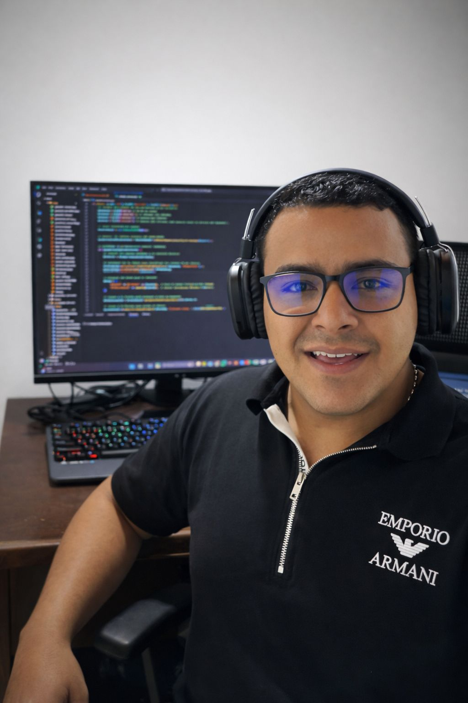

# My Portfolio - Cristian Ceballos Backend

Portafolio profesional de Cristian Camilo Ceballos Marín, Desarrollador Backend especializado en PHP, APIs REST y arquitectura MVC.

🔗 **Live Demo:** https://ceballos25.github.io/my-porfolio-cristian-ceballos-backend

---

## Tecnologías Utilizadas

### Frontend
| Tecnología | Descripción |
|------------|-------------|
| **HTML5** | Estructura semántica y accesible |
| **Tailwind CSS** | Framework CSS utility-first para diseño responsive |
| **JavaScript (ES6+)** | Interactividad y animaciones |
| **GSAP** | Animaciones avanzadas y scroll effects |
| **Three.js** | Fondo de partículas 3D interactivo |

### Herramientas y Workflow
| Herramienta | Uso |
|-------------|-----|
| **Git** | Control de versiones |
| **GitHub Pages** | Hosting y deploy continuo |
| **VS Code** | Editor de código |

---

## Estructura del Proyecto

my-porfolio-cristian-ceballos-backend/
├── index.html              # Página principal
├── css/
│   └── app.css            # Estilos personalizados
├── js/
│   └── app.js             # Lógica y animaciones
├── img/
│   └── img_portafolio.jpeg # Foto de perfil
└── README.md              # Este archivo

---

## Características

- **Diseño Responsive:** Optimizado para mobile, tablet y desktop
- **Animaciones GSAP:** Transiciones fluidas y efectos de scroll
- **Fondo 3D Interactivo:** Partículas animadas con Three.js
- **Modo Oscuro Profesional:** Paleta de colores cyan/púrpura
- **Performance Optimizado:** Carga rápida y sin dependencias pesadas

---

## 🛠️ Instalación Local

1. **Clonar el repositorio**
   
   git clone https://github.com/ccCeballos/my-porfolio-cristian-ceballos-backend.git

   cd my-porfolio-cristian-ceballos-backend
   
   open index.html

## Secciones del Portafolio
| Sección         | Descripción                                           |
| --------------- | ----------------------------------------------------- |
| **Hero**        | Presentación con foto profesional y CTAs              |
| **Sobre Mí**    | Bio, métricas (\$90M+ procesados) y card de código    |
| **Experiencia** | Timeline de trabajos (Freelance, Moda Oxford Jeans)   |
| **Proyectos**   | Sistema de Rifas, Canelia POS con métricas de impacto |
| **Stack**       | Habilidades técnicas con barras de progreso animadas  |
| **Contacto**    | Links directos a email y LinkedIn                     |

## Paleta de Colores
| Color     | Código    | Uso                             |
| --------- | --------- | ------------------------------- |
| Cyan      | `#22d3ee` | Acentos primarios, hover states |
| Púrpura   | `#a855f7` | Acentos secundarios, gradientes |
| Slate 900 | `#0f172a` | Fondo principal                 |
| Slate 800 | `#1e293b` | Cards y superficies             |

## Contacto
¿Interesado en trabajar juntos?

| Medio | Información |
|-------|-------------|
| 📧 **Email** | [ceballosmarincristiancamilo@gmail.com](mailto:ceballosmarincristiancamilo@gmail.com) |
| 💼 **LinkedIn** | [Cristian Camilo Ceballos Marín](https://www.linkedin.com/in/cristian-camilo-ceballos-marin-desarrollador-backend-java/) |
| 📱 **Teléfono** | +57 324 589 4268 |
| 📍 **Ubicación** | Medellín, Colombia |

   
